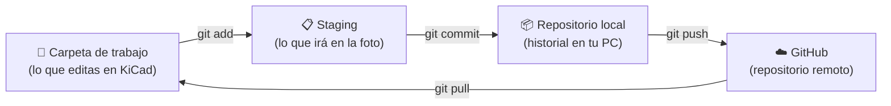
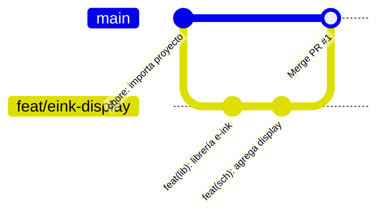

# Sesión 9: Documentación y control de versiones (guía de laboratorio)

**Curso:** 1MTR68 · Prototipado y Manufactura de Productos Mecatrónicos · **Duración:** 2 horas · **Modalidad:** individual

> **Requisito:** haber completado [00-preclase.md](00-preclase.md). Debes tener tu **carpeta de trabajo** con la carpeta `1MTR68/` adentro.
>
> En Windows usamos **PowerShell** (clic derecho en la carpeta → *Abrir en Terminal*). En macOS, la app **Terminal**: los comandos son los mismos.

## Qué vas a lograr hoy

Al terminar tendrás en **tu** GitHub un repositorio profesional de hardware con:

1. Un proyecto KiCad versionado, **sin archivos basura**.
2. Una nueva característica (display e-ink) desarrollada en una **rama** e integrada con un **Pull Request**.
3. Un **README** con diagrama de bloques.
4. Un **Release `v0.1.0`** con el PDF del esquemático adjunto.

## Cómo usar esta guía

- Los bloques `así` son comandos: **cópialos uno por uno** en la terminal.
- Donde dice `TU_USUARIO`, pon tu usuario de GitHub.
- 🔍 **Checkpoint:** compara lo que ves con lo esperado. Si no coincide, **no sigas**: revisa la sección [Si algo sale mal](#si-algo-sale-mal) o levanta la mano.
- 💡 **Por qué:** lee esto, es lo que viene en la evaluación.
- Ten a la mano la [chuleta de comandos](02-chuleta.md).

---

## Mapa mental: las 4 zonas de Git



Un **commit** es una *foto* del proyecto con una descripción de qué cambió y por qué. Nunca más `Proyecto_AHORA_SI_FINAL_definitivo.kicad_pcb`.

---

## Ejercicio 1: Tu primer repositorio de hardware (≈ 30 min)

### 1.1 Prepara la carpeta del proyecto

Abre la terminal **en tu carpeta de trabajo** (la que elegiste en la preclase, paso 6):

- Si usaste la opción A: `cd ~/proyectos`
- Si usaste la opción B: clic derecho en tu carpeta → *Abrir en Terminal*

Comprueba que estás en el lugar correcto:

```powershell
pwd
ls
```

🔍 **Checkpoint:** `ls` muestra la carpeta `1MTR68`. Si no aparece, no estás en tu carpeta de trabajo: no sigas.

Ahora copia la plantilla del proyecto a **tu propia carpeta** `demogit`:

```powershell
cp -r 1MTR68/inicio/DemoGit demogit
cd demogit
ls
```

Tu carpeta de trabajo queda así:

```
D:\Proyectos\               ← tu carpeta de trabajo
├── 1MTR68\                 ← material del curso: NO se toca, solo se consulta
│   ├── guia\
│   ├── inicio\DemoGit\      ← plantilla original
│   └── recursos\
└── demogit\                ← TU proyecto: aquí trabajas desde ahora
```

💡 **Por qué una copia:** `1MTR68` ya es un repositorio Git (el del curso). Tu proyecto debe ser un repositorio **propio**, separado. Si arruinas algo, borras `demogit` y vuelves a copiar la plantilla.

🔍 **Checkpoint:** ves `DemoGit.kicad_pro`, `DemoGit.kicad_sch`, `DemoGit.kicad_pcb`, `DemoGit.kicad_prl`, `fp-info-cache`, `sym-lib-table` y la carpeta `DemoGit-backups`.

### 1.2 Inicializa Git

```powershell
git init
git status
```

🔍 **Checkpoint:** `Initialized empty Git repository in .../demogit/.git/` y luego `On branch main`. Si dice `master`, no configuraste `init.defaultBranch` (ver preclase, paso 5). Corrígelo con `git branch -m main`.

💡 **Por qué:** `git init` crea la carpeta oculta `.git/`, donde vive todo el historial. Si la borras, pierdes el historial (pero no tus archivos).

### 1.3 Mira la basura que Git quiere rastrear

En el `git status` anterior, aparecen en rojo **todos** los archivos, incluidos:

- `DemoGit-backups/`: respaldos automáticos de KiCad (zips que crecen sin parar)
- `fp-info-cache`: caché de footprints
- `DemoGit.kicad_prl`: tus preferencias locales (capas visibles, zoom…)

Y cuando abras el proyecto con KiCad 10 aparecerá además `.history/`: el historial automático de KiCad, que es un repositorio Git propio. Tampoco debe subirse.

Nada de eso es parte del **diseño**. Si lo subes, cada compañero tendrá conflictos con *tus* preferencias.

### 1.4 Agrega `.gitignore`, `.gitattributes` y la plantilla de Pull Request

```powershell
cp ../1MTR68/recursos/kicad.gitignore .gitignore
cp ../1MTR68/recursos/kicad.gitattributes .gitattributes
mkdir -p .github
cp ../1MTR68/recursos/pull_request_template.md .github/
git status
```

🔍 **Checkpoint:** `DemoGit-backups/`, `fp-info-cache` y `DemoGit.kicad_prl` **desaparecieron** de la lista. Solo quedan en rojo:

```
.gitattributes
.github/
.gitignore
DemoGit.kicad_pcb
DemoGit.kicad_pro
DemoGit.kicad_sch
sym-lib-table
```

💡 **Por qué:** `.gitignore` le dice a Git qué **no** rastrear. Ábrelo y lee los comentarios: explica qué es fuente del diseño (se versiona) y qué es generado (no se versiona). Incluye `.history/`, la carpeta de historial de KiCad 10.

`.gitattributes` resuelve un problema típico de equipos con distintos sistemas operativos: Windows y macOS terminan las líneas de texto de forma distinta (CRLF vs LF). Sin esta regla, si tu compañero guarda el esquemático en Mac, Git cree que cambiaron **las 7000 líneas**.

### 1.5 Agrega los archivos al staging y haz tu primer commit

```powershell
git add .
git status
```

> En Windows es normal ver avisos como `warning: in the working copy of 'DemoGit.kicad_sch', CRLF will be replaced by LF...`. Es el `.gitattributes` del paso 1.4 haciendo su trabajo: **no es un error**, sigue adelante.

🔍 **Checkpoint:** ahora los archivos están en **verde** (*Changes to be committed*).

```powershell
git commit -m "chore: importa proyecto DemoGit inicial"
git log --oneline
```

🔍 **Checkpoint:** ves **una** línea, algo como `a1b2c3d (HEAD -> main) chore: importa proyecto DemoGit inicial`.

### 1.6 Crea el repositorio en GitHub

1. En GitHub: botón **+** (arriba a la derecha) → **New repository**.
2. **Repository name:** `demogit`
3. **Description:** `Nodo LoRa - 1MTR68 Sesión 9`
4. **Public** (para que el docente pueda revisarlo).
5. ⚠️ **NO marques** *Add a README*, *.gitignore* ni *license*. El repositorio debe crearse **vacío**.
6. **Create repository**.

💡 **Por qué vacío:** si GitHub crea un README, el repositorio remoto tendrá un commit que tu PC no conoce y el `push` será rechazado.

### 1.7 Conecta tu repositorio local con GitHub y sube

```powershell
git remote add origin https://github.com/TU_USUARIO/demogit.git
git remote -v
git push -u origin main
```

En Windows se abrirá el navegador para iniciar sesión la primera vez: acepta.

🔍 **Checkpoint:** la terminal termina con `branch 'main' set up to track 'origin/main'`.

💡 **Por qué:** `origin` es el apodo del repositorio remoto. `-u` deja recordado que tu `main` se sincroniza con `origin/main`; desde ahora basta `git push`.

### 1.8 Verifica en GitHub

Recarga la página de tu repositorio.

🔍 **Checkpoint:** ves tus archivos, **no** ves `DemoGit-backups` y arriba dice **1 commit**. Haz clic en `DemoGit.kicad_sch`: **¡es texto!** KiCad guarda los diseños como texto legible, por eso Git puede mostrar exactamente qué cambió.

🎉 **¡Primer repositorio de hardware creado!**

---

## Commits con formato estándar (léelo antes del Ejercicio 2)

Usaremos [Conventional Commits](https://www.conventionalcommits.org/es/v1.0.0/):

```
tipo(alcance): descripción en imperativo y en minúsculas
```

| Tipo | Cuándo | Ejemplo en hardware |
|------|--------|---------------------|
| `feat` | Nueva característica | `feat(sch): agrega display e-ink por SPI` |
| `fix` | Corrección de un error | `fix(pcb): aumenta ancho de pista de 3V3 a 0.5 mm` |
| `docs` | Solo documentación | `docs: agrega diagrama de bloques al README` |
| `refactor` | Reorganiza sin cambiar la función | `refactor(sch): divide esquemático en hojas jerárquicas` |
| `test` | Puntos de prueba, fixtures | `test(pcb): agrega test points en SPI` |
| `chore` | Mantenimiento | `chore: actualiza .gitignore` |

**Alcances sugeridos:** `sch` (esquemático), `pcb` (layout), `lib` (librerías), `bom`, `mech` (mecánica), `fw` (firmware).

✅ `fix(bom): cambia C4 a 1uF 0603 X7R`
❌ `cambios`, `ahora sí`, `final final`, `asdf`

---

## Ejercicio 2: Ramas y Pull Request (≈ 30 min)

**Escenario:** el cliente pide agregar un display e-ink. Es un cambio experimental, así que **no** lo hacemos sobre `main` (la versión estable), sino en una **rama**.



### 2.1 Crea la rama

```powershell
git switch -c feat/eink-display
git branch
```

🔍 **Checkpoint:** aparecen `main` y `* feat/eink-display`; el asterisco marca la rama actual.

> En tutoriales antiguos verás `git checkout -b feat/eink-display`, que hace lo mismo. `git switch` es la forma moderna.

### 2.2 Agrega la librería de símbolos (primer commit de la rama)

```powershell
cp -r ../1MTR68/recursos/Library .
```

Ahora en KiCad:

1. **File → Open Project…** → abre `DemoGit.kicad_pro` **de tu carpeta `demogit`**. ⚠️ No lo abras desde *Recent Projects* sin mirar la ruta: el de `1MTR68\inicio\DemoGit` se llama igual.
2. **Preferences → Manage Symbol Libraries…**
3. Pestaña **Project Specific Libraries**.
4. Clic en el ícono de **carpeta** (*Add existing library*) → selecciona `Library/E_Ink_Display.kicad_sym` → **OK**.
5. Revisa que la ruta diga `${KIPRJMOD}/Library/E_Ink_Display.kicad_sym`. Si muestra una ruta absoluta (`C:\Users\...`), corrígela a mano: con ruta absoluta el proyecto solo abre en **tu** PC.

Vuelve a la terminal:

```powershell
git status
git diff sym-lib-table
```

🔍 **Checkpoint:** `git diff` muestra en **verde** (`+`) la línea nueva con `E_Ink_Display`. **Así se ve un cambio de hardware en Git.**

> Si además aparece `DemoGit.kicad_pro` modificado, es normal: KiCad lo reescribe al abrir. Inclúyelo.

> 💡 **KiCad 10 trae Git integrado.** En el gestor de proyectos verás el nombre de la rama junto al proyecto y el estado de cada archivo. Es el **mismo** repositorio que manejas desde la terminal: no inicialices otro desde KiCad. Hoy usamos la terminal porque así entiendes lo que pasa por debajo, y los comandos sirven con cualquier programa.

```powershell
git add Library sym-lib-table
git commit -m "feat(lib): agrega librería de símbolos E_Ink_Display"
```

### 2.3 Agrega el display al esquemático (segundo commit)

1. Abre el **Schematic Editor**.
2. Tecla **A** (*Add Symbol*) → busca `E_ink` → colócalo en un espacio libre, por ejemplo debajo del bloque *Microcontroller*.
3. Asígnale la referencia **U4** (tecla **E** sobre el símbolo → *Symbol Properties*).
4. *(Opcional)* Conecta sus pines SPI con **etiquetas** (`CLK`, `COPI`) a las mismas redes del MCU.
5. **Guarda** con `Ctrl+S` / `Cmd+S`.

```powershell
git status
git diff --stat
git add DemoGit.kicad_sch
git commit -m "feat(sch): agrega display e-ink U4 al esquemático"
git log --oneline
```

🔍 **Checkpoint:** `git log` muestra **3 commits**.

💡 **Por qué dos commits y no uno:** cada commit debe ser **un** cambio lógico. Si mañana la librería falla, puedes revisar o revertir ese commit sin tocar el esquemático.

### 2.4 Sube la rama a GitHub

```powershell
git push -u origin feat/eink-display
```

### 2.5 La magia de las ramas

> ⚠️ **Cierra KiCad antes de cambiar de rama.** KiCad no recarga los archivos si cambian por debajo, y podrías sobrescribir tu trabajo al guardar.

```powershell
git switch main
```

Abre el esquemático: **el display desapareció** y la carpeta `Library/` tampoco está. Cierra KiCad.

```powershell
git switch feat/eink-display
```

Ábrelo de nuevo: **el display volvió.** Cierra KiCad.

💡 **Por qué:** cada rama es una línea de tiempo paralela. `main` siempre conserva la versión estable mientras experimentas.

### 2.6 Abre un Pull Request (PR)

1. En GitHub verás un aviso amarillo **"feat/eink-display had recent pushes"** → **Compare & pull request**. Si no aparece: pestaña **Pull requests → New pull request** → *base: `main`* ← *compare: `feat/eink-display`*.
2. El cuerpo del PR ya trae **la plantilla** que copiaste en el paso 1.4. Complétala: qué cambia, por qué, tipo de cambio y checklist.

   💡 **¿Cómo apareció sola?** GitHub busca el archivo `.github/pull_request_template.md` en la rama principal y lo usa como texto inicial de cada PR. No hay que configurar nada más: la estructura del repositorio también es documentación.
3. **Create pull request**.

### 2.7 Revisa tu propio PR como lo haría un revisor

1. Pestaña **Files changed**: revisa línea por línea lo que cambió en `sym-lib-table` y en `DemoGit.kicad_sch`.
2. Deja **un comentario** en una línea: pasa el mouse sobre la línea → **+** → por ejemplo *"Verificar que el footprint del display esté asignado antes del layout"*.
3. **Review changes → Comment → Submit review**.

💡 **Por qué:** en un equipo, **nadie** integra a `main` sin que otra persona revise. El PR deja registro de *qué* se revisó y *qué* se discutió, y es la evidencia que piden en auditorías de diseño.

### 2.8 Integra (merge) y sincroniza

1. **Merge pull request → Confirm merge**.
2. **Delete branch** (la rama ya cumplió su función).

En la terminal:

```powershell
git switch main
git pull
git log --oneline --graph
```

> Al hacer `git switch main` verás `Your branch is up to date with 'origin/main'`, y aun así `git pull` traerá cambios. No es contradictorio: Git compara con lo último que **descargó** de GitHub, y el merge ocurrió en GitHub después.

🔍 **Checkpoint:** tu `main` local ahora incluye los commits del display y el merge del PR.

Limpia la rama que ya integraste (en GitHub ya la borraste; esto la borra de tu PC):

```powershell
git branch -d feat/eink-display
git fetch --prune
```

---

## Ejercicio 3: Documentación y Release (≈ 15 min)

### 3.1 README en su propia rama

```powershell
git switch -c docs/readme
cp ../1MTR68/recursos/README_plantilla.md README.md
code README.md
```

Completa **todos los `TODO`**:

- Descripción en 2-3 frases.
- En el diagrama Mermaid, **agrega el display e-ink** conectado al MCU. Pista: copia la línea del LoRa y adáptala.
- Fila del display en la tabla de componentes.
- Tu nombre y usuario.

Para ver la vista previa en VS Code: `Ctrl/Cmd+Shift+V`. El diagrama Mermaid solo se dibujará en GitHub.

```powershell
git add README.md
git commit -m "docs: agrega README con diagrama de bloques"
git push -u origin docs/readme
```

Abre el PR en GitHub, revisa en **Files changed** → *Display the rich diff* (ícono de documento) cómo se verá, y haz **merge**. Después:

```powershell
git switch main
git pull
```

### 3.2 Release v0.1.0 para fabricación

1. En KiCad, abre el esquemático → **File → Plot…** → *Output Format*: **PDF** → *Output directory*: `production/` → **Plot All Pages**. Cierra KiCad **sin guardar**.
2. Comprueba en la terminal que Git **ignora** la carpeta `production/`:
   ```powershell
   git status
   ```
   🔍 Debe decir `nothing to commit, working tree clean`.
3. En GitHub: columna derecha → **Releases → Create a new release**.
   - **Choose a tag:** escribe `v0.1.0` → *Create new tag*.
   - **Title:** `v0.1.0 - Esquemático base con display e-ink`
   - **Descripción:** clic en **Generate release notes**: GitHub lista tus PRs automáticamente. ¡Por eso importan los buenos mensajes!
   - **Arrastra** el PDF de `production/` a la zona de adjuntos.
   - **Publish release**.

💡 **Por qué:** el *tag* `v0.1.0` marca para siempre **el commit exacto** que se mandó a fabricar. Si en 6 meses llega una placa defectuosa, sabes con qué versión de los archivos se hizo. Las salidas (PDF, gerbers, BOM) viven en el Release, no en el historial.

### Versionado semántico para hardware

`MAJOR.MINOR.SUBREVISION` (ver [Semantic versioning for hardware](https://www.maskset.net/blog/2023/02/26/semantic-versioning-for-hardware/)):

| Parte | Sube cuando… | Ejemplo |
|-------|--------------|---------|
| **MAJOR** | Cambia forma/tamaño de la placa, voltajes de entrada o salida, o se agregan interfaces nuevas | `1.4.2 → 2.0.0`: se agrega USB-C |
| **MINOR** | Cambia el esquemático o el layout | `1.4.2 → 1.5.0`: se reubica un conector |
| **SUBREVISION** | Solo cambian la BOM, los valores o los part numbers | `1.4.2 → 1.4.3`: R2 de 10k a 4.7k |

Mientras el diseño es prototipo usamos `0.x.y`. La `1.0.0` es la primera versión que se entrega.

---

## ✅ Entregable

Sube a la plataforma del curso el **enlace a tu repositorio** `https://github.com/TU_USUARIO/demogit`. Se revisará:

- [ ] El repositorio **no** contiene `DemoGit-backups/`, `fp-info-cache` ni `.kicad_prl`.
- [ ] Al menos **4 commits** con formato `tipo(alcance): descripción`.
- [ ] **2 Pull Requests** integrados (display y README), con la plantilla completa y al menos un comentario de revisión.
- [ ] El README tiene diagrama de bloques **con el display e-ink**.
- [ ] Release **`v0.1.0`** con el PDF del esquemático adjunto.

Si no terminaste en clase, termínalo en casa: las instrucciones de arriba sirven igual.

---

## 🏆 Reto opcional: tu primer conflicto

Para quienes terminan antes. Los **conflictos** ocurren cuando dos ramas modifican **la misma línea**.

```powershell
git switch -c fix/r2-4k7
```

En KiCad, cambia el valor de **R2** de `10k` a `4.7k`, guarda y cierra KiCad.

```powershell
git commit -am "fix(bom): cambia R2 a 4.7k"
git switch main
```

En KiCad, cambia **el mismo R2** a `1k`, guarda y cierra KiCad.

```powershell
git commit -am "fix(bom): cambia R2 a 1k"
git merge fix/r2-4k7
```

🔍 Verás `CONFLICT (content): Merge conflict in DemoGit.kicad_sch`. (Si también aparece conflicto en `DemoGit.kicad_pro`, resuélvelo igual que abajo.) Busca el conflicto:

```powershell
git grep -n -A4 "<<<<<<<" -- DemoGit.kicad_sch
```

```
DemoGit.kicad_sch:5206:<<<<<<< HEAD
DemoGit.kicad_sch-5207-		(property "Value" "1k"
DemoGit.kicad_sch-5208-=======
DemoGit.kicad_sch-5209-		(property "Value" "4.7k"
DemoGit.kicad_sch-5210->>>>>>> fix/r2-4k7
```

Resuélvelo eligiendo **una** versión completa del archivo:

```powershell
git checkout --theirs DemoGit.kicad_sch   # quedarse con la de la rama (4.7k)
# o:  git checkout --ours DemoGit.kicad_sch   (quedarse con la de main, 1k)
git add DemoGit.kicad_sch
git commit -m "merge: resuelve conflicto de R2, queda 4.7k"
```

Abre el esquemático y confirma el valor.

💡 **Lección de hardware:** en un esquemático un conflicto es fácil de resolver porque es **una línea**. En un `.kicad_pcb` con pistas movidas por dos personas es casi imposible. Por eso los equipos de hardware **se reparten el trabajo por hoja de esquemático o por zona de la placa** y hacen PRs pequeños y frecuentes.

---

## Si algo sale mal

| Síntoma | Causa | Solución |
|---------|-------|----------|
| `fatal: not a git repository` | No estás en la carpeta del proyecto | Ve a tu carpeta de trabajo y luego `cd demogit`. Usa `pwd` para saber dónde estás |
| `cp: cannot stat '1MTR68/inicio/DemoGit'` | No estás en tu carpeta de trabajo (la que contiene `1MTR68/`) | `pwd` y `ls`; ve a la carpeta donde está `1MTR68` |
| `mkdir` muestra un error en rojo *"already exists"* (PowerShell) | La carpeta ya existía | Nada, puedes seguir |
| Se abrió VS Code con un archivo `COMMIT_EDITMSG` o `MERGE_MSG` | Git te pide un mensaje (olvidaste `-m`, o es un merge) | Escribe el mensaje en la primera línea, guarda (`Ctrl+S`) y **cierra la pestaña**: la terminal continúa |
| `error: src refspec main does not match any` | Aún no hiciste ningún commit, o tu rama se llama `master` | Haz el commit (1.5) o `git branch -m main` |
| `! [rejected] ... (fetch first)` | Creaste el repo en GitHub **con** README | `git pull origin main --allow-unrelated-histories`, luego `git push` |
| `remote origin already exists` | Ya agregaste el remoto | `git remote set-url origin https://github.com/TU_USUARIO/demogit.git` |
| `Authentication failed` / pide contraseña | GitHub no acepta contraseñas | Windows: reinstala Git for Windows. Mac/Linux: `gh auth login` |
| `Permission denied (403)` | Escribiste mal tu usuario en la URL | `git remote -v` y corrige con `set-url` |
| `warning: ... CRLF will be replaced by LF` | Es el `.gitattributes` haciendo su trabajo | Nada, es solo un aviso |
| Se abrió una pantalla negra rara (vim) | Git pidió un mensaje y abrió vim | Escribe `:wq` y Enter. Usa siempre `-m "mensaje"` |
| `error: Your local changes would be overwritten` al cambiar de rama | Tienes cambios sin commit | Haz commit, o descártalos con `git restore .` |
| `warning: adding embedded git repository: .history` | Tu `.gitignore` no ignora la carpeta de historial de KiCad 10 | Agrega `.history/` al `.gitignore`, luego `git rm --cached .history` |
| Ya subí `DemoGit-backups` antes de poner el `.gitignore` | Git sigue rastreando lo que ya conocía | `git rm -r --cached DemoGit-backups` y luego commit |
| KiCad dice que no encuentra `E_Ink_Display` | La ruta en `sym-lib-table` es absoluta o la carpeta `Library/` no está | Revisa el paso 2.2 (debe usar `${KIPRJMOD}`) |
| En GitHub no aparece "Compare & pull request" | El aviso caduca | Pestaña **Pull requests → New pull request** |

## Para profundizar

- [Pro Git (libro gratuito, en español)](https://git-scm.com/book/es/v2)
- [Learn Git Branching (juego interactivo)](https://learngitbranching.js.org/?locale=es_AR)
- [Acerca de los Pull Requests (GitHub Docs)](https://docs.github.com/es/pull-requests/collaborating-with-pull-requests/proposing-changes-to-your-work-with-pull-requests/about-pull-requests)
- [KiRI: diff visual de esquemáticos y PCBs de KiCad](https://github.com/leoheck/kiri)
- [Introducción a Git en diseño de hardware (Altium)](https://resources.altium.com/p/introduction-git-altium-designer)
- [Git branching model de Vincent Driessen](https://nvie.com/posts/a-successful-git-branching-model/)
- [Make a README](https://www.makeareadme.com/) · [Sintaxis Markdown en GitHub](https://docs.github.com/es/get-started/writing-on-github/getting-started-with-writing-and-formatting-on-github/basic-writing-and-formatting-syntax)
- Diagramas: [Mermaid](https://mermaid.js.org/) · [WaveDrom (diagramas de tiempo)](https://wavedrom.com/tutorial.html) · [Vega-Lite](https://vega.github.io/vega-lite/)
