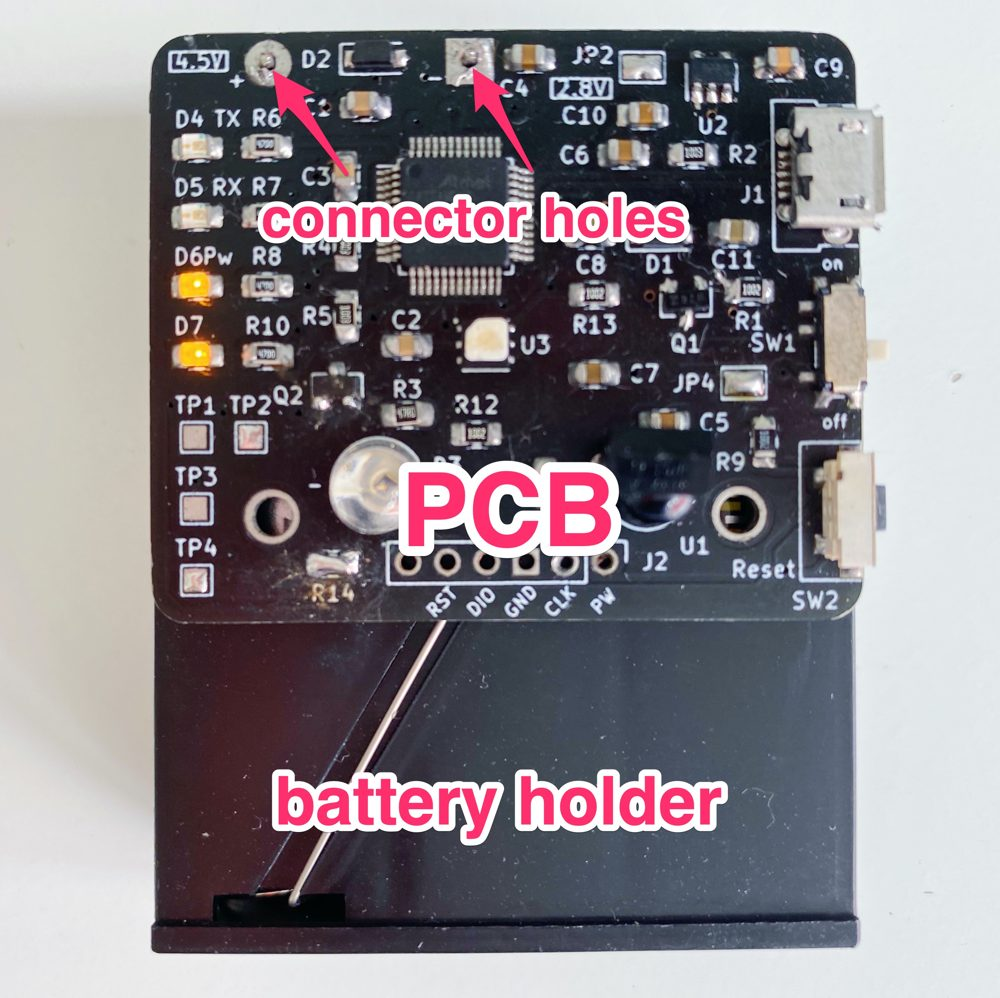

# MTR37B - Receptor LoRa

> Módulo receptor LoRa con capacidades de comunicación infrarroja y monitoreo ambiental para proyectos IoT




<!-- @import "[TOC]" {cmd="toc" depthFrom=1 depthTo=6 orderedList=false} -->

<!-- code_chunk_output -->

- [MTR37B - Receptor LoRa](#mtr37b---receptor-lora)
  - [📋 Descripción](#-descripción)
    - [Características Principales](#características-principales)
  - [🔧 Componentes Principales](#-componentes-principales)
  - [⚡ Especificaciones Eléctricas](#-especificaciones-eléctricas)
    - [Voltajes de Alimentación](#voltajes-de-alimentación)
  - [📁 Estructura del Proyecto](#-estructura-del-proyecto)
  - [🚀 Inicio Rápido](#-inicio-rápido)
    - [Requisitos de Hardware](#requisitos-de-hardware)
    - [Requisitos de Software](#requisitos-de-software)
    - [Instalación](#instalación)
  - [🔌 Pinout](#-pinout)
  - [📊 Ejemplos de Uso](#-ejemplos-de-uso)
    - [Recepción Básica LoRa](#recepción-básica-lora)
  - [🧪 Testing](#-testing)
    - [Test de Comunicación LoRa](#test-de-comunicación-lora)
    - [Test de Sensor](#test-de-sensor)
  - [🛠️ Troubleshooting](#️-troubleshooting)
  - [📐 Información de Fabricación](#-información-de-fabricación)
  - [🔄 Changelog](#-changelog)
    - [[v1.1.0] - 2024-11-15](#v110---2024-11-15)
      - [Agregado](#agregado)
      - [Corregido](#corregido)
    - [[v1.0.0] - 2024-10-01](#v100---2024-10-01)
  - [📄 Licencia](#-licencia)
  - [👥 Autores](#-autores)
  - [🙏 Agradecimientos](#-agradecimientos)
  - [📧 Contacto](#-contacto)

<!-- /code_chunk_output -->


## 📋 Descripción

El MTR37B es un receptor LoRa de bajo consumo diseñado para aplicaciones de telemetría y control remoto. Integra comunicación infrarroja bidireccional y sensado de condiciones ambientales, ideal para proyectos de automatización y monitoreo distribuido.

### Características Principales

- 📡 Comunicación LoRa de largo alcance (hasta 2km en campo abierto)
- 🔴 Emisor IR 970nm para control remoto
- 👁️ Receptor IR para recepción de comandos
- 🌡️ Sensor de temperatura y humedad integrado
- ⚡ Bajo consumo energético (<5mA en sleep mode)
- 🔋 Compatible con baterías LiPo y alimentación USB

## 🔧 Componentes Principales

| Componente | Modelo/Tipo | Función |
|-----------|-------------|---------|
| Microcontrolador | ATSAMD21G18A | Procesamiento y control principal |
| Módulo LoRa | RFM95W / SX1276 | Comunicación inalámbrica de largo alcance |
| Emisor IR | LED 970nm | Transmisión de señales infrarrojas |
| Receptor IR | TSOP38238 | Recepción de comandos IR |
| Sensor | DHT22 / SHT31 | Temperatura y humedad |

## ⚡ Especificaciones Eléctricas

### Voltajes de Alimentación

| Componente | Voltaje Operación | Consumo Típico | Notas |
|------------|-------------------|----------------|-------|
| MCU (ATSAMD21G) | 1.62V - 3.63V | 4mA @ 48MHz | 6µA en sleep |
| Sensor DHT22 | 3.3V - 5.5V | 1.5mA activo | 15µA standby |
| Módulo LoRa | 1.8V - 3.7V | 120mA TX, 12mA RX | - |
| LED IR | 1.2V - 1.4V | 100mA máx | Con resistor limitador |

**Voltaje recomendado del sistema:** 3.3V  
**Consumo total estimado:** 150mA (transmisión) / 20mA (recepción) / 50µA (sleep)

## 📁 Estructura del Proyecto
```
MTR37B/
├── README.md
├── hardware/
│   ├── pcb/
│   │   ├── MTR37B.kicad_pro
│   │   ├── MTR37B.kicad_sch
│   │   ├── MTR37B.kicad_pcb
│   │   └── gerbers/
│   ├── bom.csv
│   └── assembly_notes.md
├── firmware/
│   ├── src/
│   │   ├── main.cpp
│   │   ├── lora_handler.cpp
│   │   └── sensor_manager.cpp
│   └── platformio.ini
├── docs/
│   ├── images/
│   │   ├── pcb-connector.jpg
│   │   ├── schematic.png
│   │   └── pinout.png
│   ├── datasheets/
│   └── user_manual.md
└── examples/
    ├── basic_receive.ino
    └── sensor_reading.ino
```

## 🚀 Inicio Rápido

### Requisitos de Hardware
- Módulo MTR37B ensamblado
- Cable USB para programación
- Antena LoRa 868MHz o 915MHz (según región)
- Fuente de alimentación 3.3V o batería LiPo

### Requisitos de Software
- Arduino IDE 1.8.19+ o PlatformIO
- Librería LoRa by Sandeep Mistry
- Librería DHT sensor library by Adafruit

### Instalación

1. **Clonar el repositorio:**
```bash
git clone https://github.com/tu-usuario/MTR37B.git
cd MTR37B
```

2. **Instalar dependencias:**
```bash
# En Arduino IDE: Sketch → Include Library → Manage Libraries
# Buscar e instalar: LoRa, DHT sensor library
```

3. **Cargar firmware básico:**
```bash
cd firmware
# Abrir main.cpp en Arduino IDE
# Seleccionar placa: Arduino Zero (compatible SAMD21)
# Cargar programa
```

## 🔌 Pinout

| Pin | Función | Conexión |
|-----|---------|----------|
| PA14 | SPI MISO | LoRa MISO |
| PA15 | SPI SCK | LoRa SCK |
| PA16 | SPI MOSI | LoRa MOSI |
| PA17 | LoRa CS | LoRa NSS |
| PA18 | LoRa RST | LoRa RESET |
| PA19 | LoRa DIO0 | LoRa DIO0 |
| PA08 | IR TX | LED IR 970nm |
| PA09 | IR RX | TSOP38238 OUT |
| PA22 | I2C SDA | Sensor DHT22 |
| PA23 | I2C SCL | Sensor DHT22 |

Diagrama completo: [docs/images/pinout.png](docs/images/pinout.png)

## 📊 Ejemplos de Uso

### Recepción Básica LoRa
```cpp
#include <LoRa.h>

void setup() {
  Serial.begin(115200);
  if (!LoRa.begin(915E6)) { // 915MHz para América
    Serial.println("Error: LoRa init failed");
    while (1);
  }
  Serial.println("MTR37B: LoRa Receiver Ready");
}

void loop() {
  int packetSize = LoRa.parsePacket();
  if (packetSize) {
    Serial.print("Received: ");
    while (LoRa.available()) {
      Serial.print((char)LoRa.read());
    }
    Serial.print(" RSSI: ");
    Serial.println(LoRa.packetRssi());
  }
}
```

Más ejemplos en la carpeta [`/examples`](examples/)

## 🧪 Testing

### Test de Comunicación LoRa
1. Conectar antena
2. Cargar firmware de ejemplo
3. Verificar recepción con monitor serial (115200 baud)
4. RSSI esperado: -60dBm a -120dBm

### Test de Sensor
```bash
# En monitor serial debe mostrar:
Temp: 25.3°C | Humidity: 60.2%
```

## 🛠️ Troubleshooting

| Problema | Solución |
|----------|----------|
| LoRa no inicializa | Verificar conexiones SPI, antena conectada |
| Sin lectura de sensor | Revisar conexión I2C, verificar voltaje 3.3V |
| Alto consumo | Verificar que sleep mode esté habilitado |
| No recibe comandos IR | Verificar orientación del receptor TSOP |

## 📐 Información de Fabricación

- **Dimensiones PCB:** 50mm x 30mm
- **Capas:** 2 (Top + Bottom)
- **Grosor PCB:** 1.6mm
- **Material:** FR-4
- **Acabado superficial:** HASL sin plomo
- **Color:** Verde

**Archivos Gerber:** Disponibles en `hardware/pcb/gerbers/`

## 🔄 Changelog

### [v1.1.0] - 2024-11-15
#### Agregado
- Soporte para sensor SHT31 (I2C)
- Modo de bajo consumo mejorado

#### Corregido
- Pull-up resistors en líneas I2C (4.7kΩ)
- Ancho de pista de alimentación aumentado a 0.5mm

### [v1.0.0] - 2024-10-01
- Release inicial con funcionalidad básica

Ver [CHANGELOG.md](CHANGELOG.md) completo

## 📄 Licencia

Este proyecto está licenciado bajo MIT License - ver [LICENSE](LICENSE) para detalles.

Hardware diseñado con [KiCAD 7.0](https://www.kicad.org/)

## 👥 Autores

- **[Tu Nombre]** - Diseño hardware y firmware - [@tu-github](https://github.com/tu-usuario)

## 🙏 Agradecimientos

- Comunidad de KiCAD por los footprints
- Sandeep Mistry por la librería LoRa
- PUCP - Laboratorio de Mecatrónica

## 📧 Contacto

- Email: tu-email@pucp.edu.pe
- Issues: [GitHub Issues](https://github.com/tu-usuario/MTR37B/issues)

---

⭐ Si este proyecto te fue útil, considera darle una estrella en GitHub

**Última actualización:** Noviembre 2025
